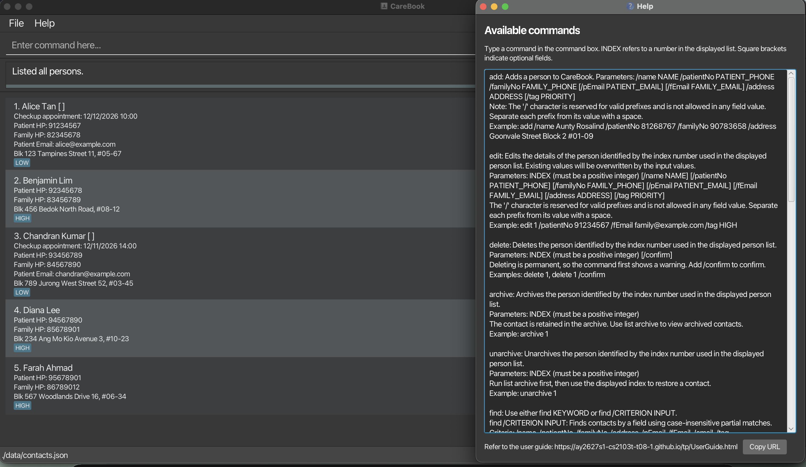
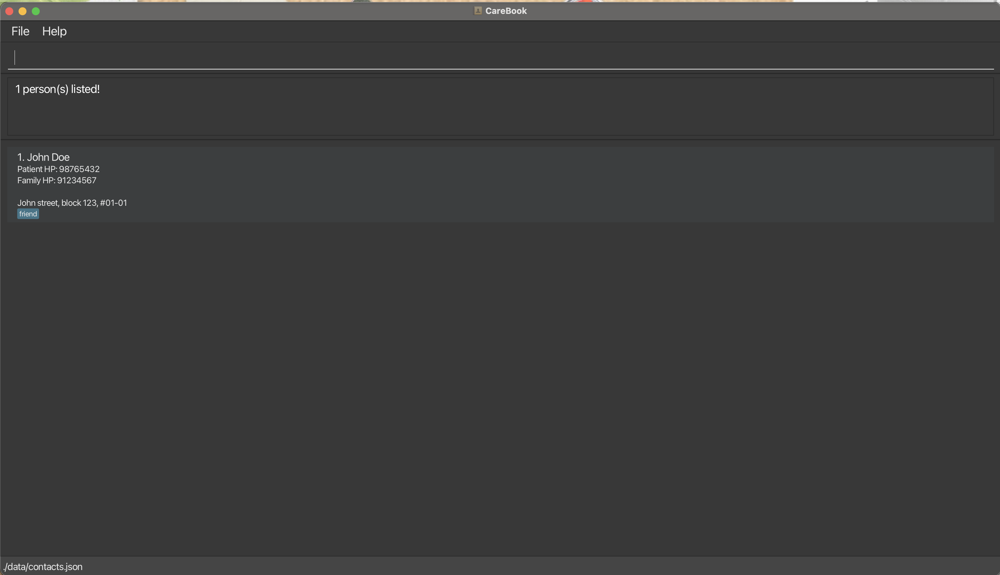

# CareBook User Guide

CareBook is a **desktop application for in-house caregivers and healthcare administrators to manage patient and family contact details, optimized for use through a Command Line Interface (CLI)** while retaining the benefits of a Graphical User Interface (GUI). If you type quickly, CareBook can help you store and retrieve contact details efficiently during day-to-day care.

<!-- * Table of Contents -->
<page-nav-print />

--------------------------------------------------------------------------------------------------------------------

## Quick start

1. Ensure that Java `25` or later is installed on your computer.<br>
   **Mac users:** Ensure you have the precise JDK version prescribed [here](https://se-education.org/guides/tutorials/javaInstallationMac.html).

1. Download the latest `.jar` file from [CareBook releases](https://github.com/AY2627S1-CS2103T-T08-1/tp/releases).

1. Copy the file to the folder you want to use as the _home folder_ for CareBook.

1. Open a terminal, `cd` to the folder containing the JAR file, and run `java -jar carebook.jar`.<br>
   A GUI similar to the one below should appear in a few seconds. The app starts with an empty contact list the first time you run it.<br>
   

1. Type a command in the command box and press Enter to execute it. For example, type **`help`** and press Enter to open the help window.<br>
   Some example commands you can try:

   * `list` : Lists all contacts.

   * `add /name John Doe /patientNo 98765432 /familyNo 91234567 /pEmail johnd@example.com /fEmail family@example.com /address John street, block 123, #01-01` : Adds a contact named `John Doe` to the CareBook.

   * `delete 3` : Deletes the 3rd contact shown in the current list.

   * `clear` : Deletes all contacts.

   * `exit` : Exits the app.

1. Refer to the [Features](#features) section below for details of each command.

--------------------------------------------------------------------------------------------------------------------

## Features

<box type="info" seamless>

**Notes about the command format:**<br>

* Words in `UPPER_CASE` are the parameters to be supplied by the user.<br>
  For example, in `add /name NAME`, replace `NAME` with a value such as `John Doe`.

* Items in square brackets are optional.<br>
  For example, `/name NAME [/tag PRIORITY]` can be used as `/name John Doe /tag HIGH` or as `/name John Doe`.

* Items followed by `...` can appear zero or more times.<br>
  For example, `find KEYWORD [MORE_KEYWORDS]...` can be written as `find John` or `find John Mary`.

* Parameters can be in any order.<br>
  For example, if the command specifies `/name NAME /patientNo PATIENT_PHONE`, `/patientNo PATIENT_PHONE /name NAME` is also acceptable.

* Extraneous parameters for commands that take no parameters, such as `help`, `exit`, and `clear`, are ignored.<br>
  For example, `help 123` is interpreted as `help`. The `list` command rejects extra parameters; enter `list` on its own.

* If you are using a PDF version of this document, be careful when copying and pasting commands that span multiple lines as space characters surrounding line-breaks may be omitted when copied over to the application.
</box>

### Viewing help: `help`

Shows a message explaining how to access the help page.


Format: `help`


### Adding a person: `add`

Adds a person to CareBook.

Format: `add /name NAME /patientNo PATIENT_PHONE /familyNo FAMILY_PHONE [/pEmail PATIENT_EMAIL] [/fEmail FAMILY_EMAIL] /address ADDRESS [/tag PRIORITY] `

Note: `FAMILY_PHONE` and `FAMILY_EMAIL` can refer to the patient's emergency contact or another specified family member. 

<box type="tip" seamless>

**Tip:** A person can have no priority tag or one priority tag: `HIGH`, `MEDIUM`, or `LOW`. Repeating the same tag stores it only once.
</box>

Examples:
* `add /name Aunty Rosalind /patientNo 81268767 /familyNo 90783658 /address Goonvale Street Block 2 #01-09`
* `add /name John Doe /patientNo 98765432 /familyNo 91234567 /pEmail johnd@example.com /fEmail family@example.com /address John street, block 123, #01-01 /tag HIGH`

### Priority tags

Use `/tag PRIORITY` with `add` or `edit` to label a person's priority. Choose one of the three supported values: `HIGH`, `MEDIUM`, or `LOW`. Custom priority names are not supported.

* The `/tag` prefix and priority values are case-insensitive: `/tag High`, `/TAG high`, and `/TaG HIGH` all assign `HIGH`. Tags are displayed and saved in uppercase. Free-form tags such as `/tag friend` are invalid.
* Spaces before and after a priority value are ignored in commands.
* Only one distinct priority is allowed. `/tag HIGH /tag LOW` is rejected with `A contact can have at most one priority tag.` Repeating `/tag High /TAG high` stores one `HIGH` tag. `/tag HIGH LOW` is also invalid.
* Omitting `/tag` when adding a person leaves them without priority tags. A bare `/tag` is invalid for `add`.
* The assigned priority tag appears on the person's card.

An invalid priority displays `Tag names must be HIGH, MEDIUM or LOW` and leaves the contacts unchanged.

### Listing all persons: `list`

Shows a list of all persons in CareBook.

Format: `list`

**Common errors:**

| Incorrect input | Error message | How to correct it |
| --- | --- | --- |
| `list 3` | `Invalid command format. List command format: list` | Remove the index. Use `list` to show all persons. |
| `list Alice` or `list n/Alice` | `Invalid command format. List command format: list` | Use `find Alice` to search by name, or `list` to show all persons. |
| `LIST` or `List` | `Unknown command.` | Use the lowercase command `list`. |

The `list` command accepts no arguments. Leading and trailing spaces are allowed.
If all persons are already displayed, `list` leaves the displayed list unchanged and shows `Listed all persons.`;
this is normal behavior. After a `find` command, use `list` to display all persons again.

### Viewing a person's full details: `view`

Displays only the specified person and shows their full details in the result box.

Format: `view INDEX`

* Displays the person at the specified `INDEX`.
* The index refers to the index number shown in the displayed person list.
* The index **must be a positive integer** 1, 2, 3, ...
* Use `list` to display all persons again.

Example:
* `view 2` displays the full details of the 2nd person in the displayed list.

### Editing a person: `edit`

Edits an existing person in CareBook.

Format: `edit INDEX [/name NAME] [/patientNo PATIENT_PHONE] [/familyNo FAMILY_PHONE] [/email EMAIL] [/address ADDRESS] [/tag PRIORITY] `

* Edits the person at the specified `INDEX`. The index refers to the index number shown in the displayed person list. The index **must be a positive integer** 1, 2, 3, ...
* At least one of the optional fields must be provided.
* Existing values will be updated to the input values.
* Priority values must be `HIGH`, `MEDIUM`, or `LOW`, in any letter case (see [Priority tags](#priority-tags)).
* Supplying `/tag PRIORITY` replaces the person's existing priority tag. Omitting `/tag` leaves their tags unchanged.
* To remove all of a person's priority tags, supply a single `/tag` without a value. Combining an empty `/tag` with other tags is invalid.

Examples:
*  `edit 1 /patientNo 91234567 /email johndoe@example.com` Edits the patient phone number and email address of the 1st person to be `91234567` and `johndoe@example.com` respectively.
*  `edit 1 /TAG Medium` Replaces the priority tag of the 1st person with `MEDIUM`.
*  `edit 2 /name Betsy Crower /tag` Edits the name of the 2nd person to be `Betsy Crower` and clears all existing tags.

### Locating persons by name: `find`

Finds persons whose names contain any of the given keywords. Partial matches are now supported.

Format: `find KEYWORD [MORE_KEYWORDS]`

* The search is case-insensitive; for example, `hans` matches `Hans`.
* Keyword order does not matter; for example, `Hans Bo` matches `Bo Hans`.
* Persons matching at least one keyword are returned (an `OR` search); for example, `Hans Bo` returns `Hans Gruber` and `Bo Yang`
* The search considers only names.
* Partial finds are supported; for example, `ha` matches `Hans`, `Johan` and `Anne Ha`.
* The substring must match; for example, `ha` will not match `Henry Avril`.

Examples:
* `find John` returns `john` and `John Doe`
* `find alex david` returns `Alex Yeoh`, `David Li`<br>
  
* `find j` returns `John Doe`<br> 

### Filtering persons by tag: `filter`

Shows only the persons who are tagged with the given tag.

Format: `filter TAG`

* `TAG` must be one of `HIGH`, `MEDIUM` or `LOW`.
* The tag is case-insensitive; for example, `medium` matches persons tagged `MEDIUM`.
* Only persons who have the exact tag are returned.
* Exactly one tag must be given.

Examples:
* `filter MEDIUM` lists all persons tagged as `MEDIUM`.
* `filter high` lists all persons tagged as `HIGH`.

**Common errors:**

| Incorrect input | Error message | How to correct it |
| --- | --- | --- |
| `filter` (no tag) | `Invalid command format!` followed by the correct usage | Supply a tag, e.g. `filter MEDIUM`. |
| `filter URGENT` (not a valid tag) | `Invalid command format!` followed by the correct usage | Use one of `HIGH`, `MEDIUM` or `LOW`. |
| `filter HIGH LOW` (more than one tag) | `Invalid command format!` followed by the correct usage | Give only one tag per command. |

After a `filter` command, use `list` to display all persons again.

### Deleting a person: `delete`

Deletes the specified person from CareBook.

Format: `delete INDEX`

* Deletes the person at the specified `INDEX`.
* The index refers to the index number shown in the displayed person list.
* The index **must be a positive integer** 1, 2, 3, ...
* The command word `delete` is case-insensitive, e.g. `Delete 1` and `DELETE 1` also work.

Examples:
* `list` followed by `delete 2` deletes the 2nd person in CareBook.
* `find Betsy` followed by `delete 1` deletes the 1st person in the results of the `find` command.

Common errors:

Input | Error message shown | How to fix
------|---------------------|-----------
`delete` (no index) | `Invalid command format!` followed by the correct usage | Supply an index, e.g. `delete 1`
`delete abc` | `Invalid command format!` followed by the correct usage | Use a number, not text
`delete 1 2` | `Invalid command format!` followed by the correct usage | Use a single index per command
`delete 0` / `delete -1` | `Index must be a positive integer.` | Use an index of 1 or more
`delete 99` (out of range) | `The index provided is out of range. The displayed list has 3 person(s), so the index must be from 1 to 3.` | Use an index shown in the displayed list
`delete 1` (displayed list is empty) | `There are no persons in the displayed list to delete.` | Run `list` to show all persons, or add a person first 

### Clearing all entries: `clear`

Clears all entries from CareBook.

Format: `clear`

### Exiting the program: `exit`

Exits the program.

Format: `exit`

### Saving the data

CareBook automatically saves data after every command that changes your contacts (such as `add`, `edit` and `delete`). Commands that only show information, such as `list` and `find`, do not trigger a save. You do not need to save manually.

### Editing the data file

CareBook data is saved automatically as a JSON file `[JAR file location]/data/contacts.json`. Advanced users are welcome to update data directly by editing that data file.

The file is a JSON object with a `contacts` list. Each contact has these fields:

| Field       | Required | Description                                  |
|-------------|----------|----------------------------------------------|
| `name`      | Yes      | The contact's name.                          |
| `patientNo` | Yes      | The patient's phone number.                  |
| `familyNo`  | Yes      | The family member's phone number.            |
| `pEmail`    | No       | The patient's email address. Leave it out if the patient has no email. |
| `fEmail`    | No       | The family member's email address. Leave it out if the family member has no email. |
| `address`   | Yes      | The contact's address.                       |
| `tags`      | No       | A list containing at most one priority: `HIGH`, `MEDIUM`, or `LOW`. Use `[]` for no tags.       |

Example:

```
{
  "contacts" : [ {
    "name" : "Alice Pauline",
    "patientNo" : "94351253",
    "familyNo" : "81234567",
    "address" : "123, Jurong West Ave 6, #08-111",
    "tags" : [ "HIGH" ]
  } ]
}
```

Commands accept any letter case, but priority strings edited directly in the data file must match exactly, including uppercase letters and no surrounding spaces. Older free-form tags such as `"friends"` are no longer valid and are not converted automatically. Before opening an older data file in this version, back it up and, with CareBook closed, keep only one appropriate priority per contact or clear the list to `[]`. Lists with multiple distinct priorities are invalid and prevent the data file from loading. Omitting the `tags` field also means no priority tags.

<box type="warning" seamless>

**Caution:**
If your changes make the data file invalid, CareBook shows the message "Data file could not be loaded. Starting with an empty contact list." and starts with an empty contact list. The invalid file remains on disk until you run a command that changes your contacts, which overwrites it. Still, we recommend backing up the file before editing it.<br>
Furthermore, certain edits can cause CareBook to behave in unexpected ways (e.g., if a value entered is outside of the acceptable range). Therefore, edit the data file only if you are confident that you can update it correctly.
</box>

### Archiving data files `[coming in v2.0]`

_Details coming soon ..._

--------------------------------------------------------------------------------------------------------------------

## FAQ

**Q**: How do I transfer my data to another computer?<br>
**A**: Install the app on the other computer and overwrite the data file it creates with the data file from your previous CareBook home folder.

--------------------------------------------------------------------------------------------------------------------

## Known issues

1. **When using multiple screens**, if you move the application to a secondary screen, and later switch to using only the primary screen, the GUI will open off-screen. The remedy is to delete the `preferences.json` file created by the application before running the application again.
2. **If you minimize the Help Window** and then run the `help` command (or use the `Help` menu, or the keyboard shortcut `F1`) again, the original Help Window will remain minimized, and no new Help Window will appear. The remedy is to manually restore the minimized Help Window.

--------------------------------------------------------------------------------------------------------------------

## Command summary

Action     | Format, Examples
-----------|----------------------------------------------------------------------------------------------------------------------------------------------------------------------
**Add**    | `add /name NAME /patientNo PATIENT_PHONE /familyNo FAMILY_PHONE [/pEmail PATIENT_EMAIL] [/fEmail FAMILY_EMAIL] /address ADDRESS [/tag PRIORITY] ` <br> e.g., `add /name James Ho /patientNo 22224444 /familyNo 93334444 /pEmail jamesho@example.com /fEmail jamesfamily@example.com /address 123, Clementi Rd, 1234665 /tag HIGH`
**Clear**  | `clear`
**Delete** | `delete INDEX`<br> e.g., `delete 3`
**Edit**   | `edit INDEX [/name NAME] [/patientNo PATIENT_PHONE] [/familyNo FAMILY_PHONE] [/email EMAIL] [/address ADDRESS] [/tag PRIORITY] `<br> e.g.,`edit 2 /name James Lee /email jameslee@example.com`
**Find**   | `find KEYWORD [MORE_KEYWORDS]`<br> e.g., `find James Jake`
**Filter** | `filter TAG`<br> e.g., `filter MEDIUM`
**List**   | `list`
**View**   | `view INDEX`<br> e.g., `view 2`
**Help**   | `help`
